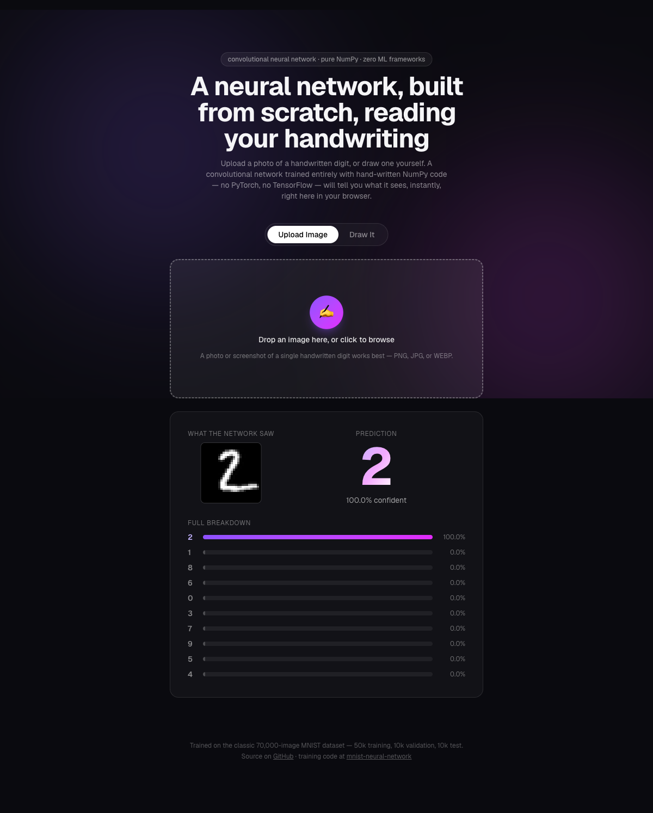

# mnist-digit-recognizer

A web app that recognizes handwritten digits using a neural network
trained **entirely from scratch** — no ML framework anywhere in this
repo, not even in the browser. The network itself (its forward pass) is
re-implemented from first principles in plain TypeScript, and the
weights it uses were trained in a companion project,
[**mnist-neural-network**](https://github.com/karthiknarayan01/mnist-neural-network),
which trains the same network using nothing but NumPy.

**🔗 Try it live: [mnist-digit-recognizer-coral.vercel.app](https://mnist-digit-recognizer-coral.vercel.app)**



## How it works

Everything happens client-side, in your browser — there's no backend
server making predictions, and your image never leaves your device.

1. **You provide a digit.** Either upload a photo/screenshot of a
   handwritten digit, or draw one directly on the canvas.
2. **Preprocessing** ([`lib/preprocess.ts`](lib/preprocess.ts)) converts
   whatever you provided into the exact style of image the network
   learned from: grayscale, inverted if needed so the digit is light on
   a dark background, cropped to the digit itself, scaled into a 28×28
   pixel grid, and centered by **center of mass** — not just its
   bounding box — mirroring exactly how the original MNIST dataset
   itself was built. This turned out to matter a lot: the trained
   network is quite sensitive to exact pixel placement, and switching
   from bounding-box centering to center-of-mass centering was the
   difference between flaky, sub-90%-confidence guesses and consistent
   99%+ confidence on real uploaded images.
3. **Prediction** ([`lib/convNetwork.ts`](lib/convNetwork.ts)) runs
   that 28×28 image through a TypeScript re-implementation of the
   trained convolutional network's forward pass — the same math as the
   Python training project's `ConvNetwork.forward`, just written with
   plain nested loops over a single image instead of NumPy's batched
   array operations — and returns a confidence score for every digit
   0–9.
4. **The UI** shows the network's top guess, its confidence, and a full
   breakdown across all 10 digits.

The trained weights live in
[`public/model/trained_cnn.json`](public/model/trained_cnn.json),
exported directly from the Python project — nothing in this repo trains
anything; it only *uses* a network that was already trained elsewhere.

## The network, in brief

```
28x28x1 image
    -> Conv2D(1 -> 20 filters, 5x5)     => 24x24x20
    -> ReLU
    -> MaxPool2D(2x2)                   => 12x12x20
    -> Dense(2880 -> 100) -> ReLU -> Dense(100 -> 10) -> softmax
```

A small convolutional neural network (CNN): one layer of 20 filters
scans the image for simple patterns, a pooling layer shrinks the
result, and the same kind of fully-connected "voting" layers then
decide the digit. Trained with softmax cross-entropy, L2
regularization, and mini-batch SGD. **98.96% test accuracy** — beating
the plain network's 98.47% (even with 11x more training data via
augmentation) using less data and less training time.

This repo also ships
[`lib/network.ts`](lib/network.ts) — a from-scratch re-implementation
of a *plain, fully-connected* network (98.47% test accuracy on its
own), kept here for comparison. Curious what the difference actually is
and why the CNN does better? The training repo's README links a
genuinely kid-friendly PDF explaining it with pictures. Full details,
benchmarks, and the training code for both networks are in the
[mnist-neural-network](https://github.com/karthiknarayan01/mnist-neural-network)
repo.

## Running it locally

```bash
git clone https://github.com/karthiknarayan01/mnist-digit-recognizer.git
cd mnist-digit-recognizer
npm install
npm run dev
```

Open [http://localhost:3000](http://localhost:3000).

## Tech stack

- [Next.js](https://nextjs.org/) (App Router) + TypeScript
- [Tailwind CSS](https://tailwindcss.com/) for styling
- No ML framework, no backend — the neural network's forward pass is
  plain TypeScript, entirely client-side.
- Deployed on [Vercel](https://vercel.com/).

## Project structure

```
mnist-digit-recognizer/
├── app/
│   ├── page.tsx         # the app's single page
│   ├── layout.tsx
│   └── globals.css
├── components/
│   ├── UploadZone.tsx   # drag-and-drop / click-to-browse image upload
│   ├── DrawPad.tsx       # draw a digit with mouse/touch
│   └── PredictionPanel.tsx  # displays the prediction + confidence breakdown
├── lib/
│   ├── preprocess.ts    # turns any uploaded image into network-ready pixels
│   ├── convNetwork.ts   # the CNN's forward pass, in TypeScript (used by the app)
│   └── network.ts       # the plain dense network's forward pass (kept for comparison)
└── public/model/
    ├── trained_cnn.json       # the CNN's trained weights (used by the app)
    └── trained_network.json   # the dense network's trained weights
```

## License

[MIT](LICENSE)
